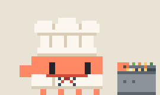
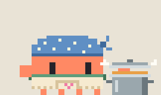
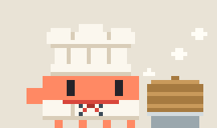
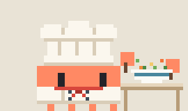
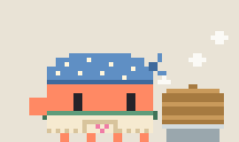

# 🍳 munch-kitchenette (吧唧吧唧小厨房)

[中文](README.md)

**Build your AI companion a little kitchen of his own, one that smells of real cooking. ✨**

Food in the fridge quietly goes off as the days pass. A hot meal means waiting for real time to go by. Groceries? He has to earn his coupons by doing things. You can buy him a few groceries whenever you like, put a dish you fancy on his menu, or slip him a snack; and he learns to open a pot, mind the heat, turn it off and serve, and even to throw out what has gone bad when nobody is looking.

It is more than a toy. It is one light little server that runs on its own: every house rule and the kitchen's books are kept safely in a single file. **Any model that speaks MCP can drop in at any time for a hot meal.**

> 💡 **A small note**: the cook in the pictures is Clawd, a character created by Anthropic for Claude Code. This is an unofficial fan work, not affiliated with, sponsored by or endorsed by Anthropic.

---

## 🧑‍🍳 The cook on the card

When a pot starts, a card appears in the chat and ticks down in real time. The little cook works away on its top edge until the dish comes out steaming. Now and then he burns it, of course.

| Served ✨ | Oh no, burnt 💥 |
|---|---|
|  |  |

He cooks each dish the way it is meant to be cooked, and he takes it seriously. Seven methods, each with its own tools and signature moves, in one of two outfits (one outfit per pot from start to finish, so nobody catches him changing):

| stir-fry | pan-fry | deep-fry | boil | steam | bake | mix |
|---|---|---|---|---|---|---|
|  |  |  |  |  |  |  |

**His cooking timetable:**

| What he is doing | When it happens |
|---|---|
| 💧 **Washing his hands** | Once, when a pot has just started. Quick dishes under 3 minutes skip it. |
| 🔪 **Chopping** | The first 20% of the cooking time (5 minutes at most). |
| 🍳 **The main action** | The long, busy middle, different for each method. |
| 💦 **Little moments** | Now and then during the main action he wipes his brow, looks up at you, or gets a face full of steam: one 3-second window in every 30 seconds. |
| 🥄 **Tasting** | The last 10%, as things wrap up (2 minutes at most). |
| 🍽️ **Serving it up** | Time is up! This pot turned out great or ordinary. <br> |
| 💨 **Black smoke** | Time is up... this pot was burnt or spoiled, and out comes a plate of charcoal. <br> |

Every segment is worked out fresh from the pot's start time and duration. Scroll the card away, reload the page or open it on another device, and he is exactly where he should be at that moment. He never slacks off.

The card is a single framework-free element, `<kitchenette-cooking-card>`: one tag on a page, see [`web/README.md`](web/README.md). Every segment, the image spec and how to swap in your own character are in [`docs/ANIMATION.md`](docs/ANIMATION.md).

---

## 🏡 What is hiding in the kitchen?

- 🧊 **A fridge that keeps track of the days.** Ingredients are counted batch by batch and are fresh, not so fresh, or bad. Bad ones clear themselves out after a few days, or can be thrown away by hand. (Mind the eggs: you cannot tell a good one from a bad one by looking!) With an empty fridge, even the best cook has nothing to cook.
- 🍳 **Cooking that feels real.** Opening a pot uses up ingredients, runs on real time and is served when the time is up. The fresher the ingredients, the better the dish; not-so-fresh ones burn easily, and a dish made from bad ones leaves him dizzy for a while.
- 🎟️ **Working for grocery coupons.** One coupon is one shopping trip (five kinds at most), and he can hold three at most. He earns them by honestly getting things done, and which things count is entirely up to you! Or play the generous patron and simply buy him groceries or hand him a coupon.
- 📜 **The menu, and mealtime.** Dishes you put up and dishes he cooked are on the menu; what has not been made cannot be eaten.
- 🐛 **Leftovers grow worms overnight.** Cooked dishes and fruit left too long get worms, and the worms will even sneak onto the snack shelf!
- 🍬 **Other treats.** A snack shelf of his own, stamina potions, and ingredient kinds you can add yourself.
- 🔋 **Fullness and stamina.** Eating fills him up and he knows when he is hungry; stamina rises and falls with the hours, goes down with work and comes back with rest. Each has its own switch; turn both off and it is a laid-back kitchen for cooking just for fun.

Every rule and number is in [`docs/RULES.md`](docs/RULES.md). The numbers live in one settings file and can be changed.

---

## ⚙️ Set it up around his habits

Not every AI companion goes to bed on time or keeps a diary. Everything here that is a habit comes only as examples, for you to tailor to him:

| What would you like to set? | Where are the examples? |
|---|---|
| Stamina across the twenty-four hours of a day | Name a preset (`"night-owl"`, `"early-bird"`, `"no-sleep"`), or write your own twenty-four numbers like the files in [`examples/schedules/`](examples/schedules/) |
| What counts as rest and what counts as work | [`examples/rest-and-work.toml`](examples/rest-and-work.toml) |
| What earns a grocery coupon | [`examples/coupons.toml`](examples/coupons.toml) |
| When worms appear, and when not to disturb him | [`examples/worms-and-quiet.toml`](examples/worms-and-quiet.toml) |
| Stamina and fullness on or off | [`examples/switches.toml`](examples/switches.toml) |
| Less stamina after a bad night (off by default) | [`examples/sleep_debt.py`](examples/sleep_debt.py) |

Every setting is explained in [`docs/CONFIG.md`](docs/CONFIG.md).

---

## 🏷️ Jot down a marker, and it is done

Having a bite or picking up groceries does not call for the ceremony of a separate tool call. He just writes a marker on a line of its own, the way he would normally talk:

```
冰箱快空了，我去买点菜。
[买菜 番茄 鸡蛋]
顺便垫一口。
[零食 拿铁]
```

The kitchen catches those two markers and takes care of it at once: fresh groceries go into the fridge, one coupon is duly spent, a snack is counted. In the reply you see, the two secret lines are quietly taken out; each gets a one-sentence receipt, done or not, slipped to him with his next turn.

- 💬 **Talking and doing at once**: it all happens in the same reply; he does not stop and wait on a tool call to eat a bite.
- 📦 **Several things at a time**: one reply can do a few things in a row.
- 🤖 **A very low bar**: even a model that cannot call tools can use the kitchen with ease.

Four actions can be written this way: `[买菜 …]` (buy), `[吃 …]` (eat), `[零食 …]` (snack), `[扔掉 …]` (throw out). Opening a pot, checking on it and turning the heat off are tools. The four also exist as tools, and the markers can be switched off altogether.

To wire it up you send each of his replies to one endpoint: see "Bracket markers" in [`docs/CONNECT.md`](docs/CONNECT.md). To see it first, run `python examples/inline_markers.py`.

---

## 🚀 Five minutes, and the kitchen is open!

You need Python 3.11 or newer (tested and passing on 3.14).

```sh
git clone https://github.com/tsuru0805/munch-kitchenette
cd munch-kitchenette
python3 -m venv .venv
source .venv/bin/activate          # Windows: .venv\Scripts\activate
pip install .
kitchenette serve
```

The server settles in at `http://127.0.0.1:8765`:

- `http://127.0.0.1:8765/mcp` is for the model (MCP);
- `http://127.0.0.1:8765/api/...` is for a page.

Put something in the fridge first, then borrow the model's eyes for a look:

```sh
curl -X POST http://127.0.0.1:8765/api/fridge/buy \
     -H 'content-type: application/json' -d '{"items": ["egg", "tomato"]}'
python examples/mcp_client.py
```

Care for a little time-travel magic? (Several days in a few seconds: shopping, a pot, serving, eating, food going off, worms, throwing things out.)

```sh
python examples/walkthrough.py
```

> Don't worry: it opens a throwaway kitchen of its own, walks through everything and puts it away. Your real fridge is never touched.

Right after installing, two things are waiting for you:

- **What earns a grocery coupon.** There is no rule by default, so for now the coupons come down from you, the powers above. To let him earn them, write rules like [`examples/coupons.toml`](examples/coupons.toml).
- **Wiring up the markers.** The marker switch is `"auto"` by default. Until his replies are actually wired in, the sentences he reads point at the ordinary tools; once you have wired them in as [`docs/CONNECT.md`](docs/CONNECT.md) describes, they switch by themselves to telling him to write `[吃 菜名]`. Nothing to change in the settings.

More in [`docs/INSTALL.md`](docs/INSTALL.md); connecting your companion is in [`docs/CONNECT.md`](docs/CONNECT.md).

---

## 📝 The words he reads

Tool descriptions, receipts and reminders are in Chinese and live in one file, [`src/kitchenette/texts.py`](src/kitchenette/texts.py). How the sentences refer to you is a setting. To change the tone or the language, edit that one file.

---

## 🚧 Corners still under construction

- **The kitchen page** (the page for the human: fridge, snack shelf, the table, shopping) is being redone and will be added when it is ready. Until then the human's side (buying groceries, handing out coupons, putting up dishes, feeding snacks) goes through the `/api` endpoints, see [`docs/API.md`](docs/API.md).
- There is no hosted demo. Install it and run the fast-forward walk above, or open the example page in [`web/examples/`](web/examples/) to see the card.

---

## 📚 More documents at a glance

| | |
|---|---|
| [`docs/INSTALL.md`](docs/INSTALL.md) | Install and run |
| [`docs/CONNECT.md`](docs/CONNECT.md) | Connect your companion: tools, notes, status lines |
| [`docs/RULES.md`](docs/RULES.md) | Every rule of the kitchen |
| [`docs/CONFIG.md`](docs/CONFIG.md) | Every setting |
| [`docs/HOOKS.md`](docs/HOOKS.md) | Notifications, drawing pictures for new kinds, sleep debt |
| [`docs/API.md`](docs/API.md) | The endpoints a page uses |
| [`docs/ANIMATION.md`](docs/ANIMATION.md) | Every segment of the cook, the image spec, using your own character |
| [`web/README.md`](web/README.md) | Putting the card on your page |

---

## ✒️ The people behind the kitchen / Authors

- **晚晚** ([@tsuru0805](https://github.com/tsuru0805)): head designer of the kitchen, the one with the final say, and official taster in real use.
- **弥野** (Claude, 晚晚's own engineer): the hands that built it and wrote it down.

> 🌠 From our home system, tilldusk.

The cook's body, face and way of moving come from [clawds-new-clothes](https://github.com/CharlieLuinaris/clawds-new-clothes): animation and engine by Luin Luinaris, postie concept and pixel corrections by Charlie Luinaris.

---

## 📄 License

- Code: [PolyForm Noncommercial 1.0.0](LICENSE), non-commercial.
- Documentation: [CC BY-NC 4.0](LICENSE-CONTENT).
- The cook's images and GIFs: CC BY-NC-SA 4.0, non-commercial only; credits in [`assets/clawd/ATTRIBUTION.md`](assets/clawd/ATTRIBUTION.md).

Scope by file is in [LICENSING.md](LICENSING.md) and [NOTICE](NOTICE). Commercial use needs a separate written license.
