# 🍳 munch-kitchenette (吧唧吧唧小厨房)

[中文](README.md)

> 🆕 **Installed the previous version?** [From 0.2.1 to 0.2.2: one command, your data moves over by itself →](docs/UPGRADE.md#upgrade-0.2.2)

**Build your AI companion a little kitchen of his own, one that smells of real cooking. ✨**

Food in the fridge quietly goes off as the days pass. A hot meal means waiting for real time to go by. Groceries? He has to earn his coupons by doing things. You can buy him a few groceries whenever you like, put a dish you fancy on his menu, or slip him a snack; and he learns to open a pot, mind the heat, turn it off and serve, and even to throw out what has gone bad when nobody is looking.

It is more than a toy. It is one light little server that runs on its own: every house rule and the kitchen's books are kept safely in a single file. **Any model that speaks MCP can drop in at any time for a hot meal.**

> 💡 **A small note**: the cook in the pictures is Clawd, a character created by Anthropic for Claude Code. This is an unofficial fan work, not affiliated with, sponsored by or endorsed by Anthropic.

---

## 🧑‍🍳 The cook on the card

When a pot starts, a card appears in the chat and ticks down in real time. The little cook works away on its top edge until the dish comes out steaming. Now and then he burns it, of course.

| Served ✨ | Oh no, burnt 💥 |
|---|---|
| 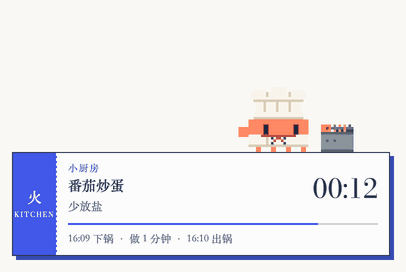 | 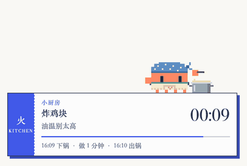 |

He cooks each dish the way it is meant to be cooked, and he takes it seriously. Seven methods, each with its own tools and signature moves, in one of two outfits (one outfit per pot from start to finish, so nobody catches him changing):

| stir-fry | pan-fry | deep-fry | boil | steam | bake | mix |
|---|---|---|---|---|---|---|
|  | 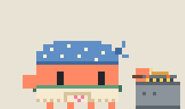 | 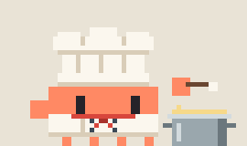 |  |  |  |  |

**His cooking timetable:**

| What he is doing | When it happens |
|---|---|
| 💧 **Washing his hands** | Once, when a pot has just started. Quick dishes under 3 minutes skip it. |
| 🔪 **Chopping** | The first 20% of the cooking time (5 minutes at most). |
| 🍳 **The main action** | The long, busy middle, different for each method. |
| 💦 **Little moments** | Now and then during the main action he wipes his brow, looks up at you, or gets a face full of steam: one 3-second window in every 30 seconds. |
| 🥄 **Tasting** | The last 10%, as things wrap up (2 minutes at most). |
| 🍽️ **Serving it up** | Time is up! This pot turned out great or ordinary. <br>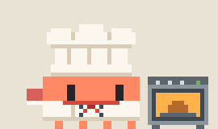 |
| 💨 **Black smoke** | Time is up... this pot was burnt or spoiled, and out comes a plate of charcoal. <br> |

Every segment is worked out fresh from the pot's start time and duration. Scroll the card away, reload the page or open it on another device, and he is exactly where he should be at that moment. He never slacks off.

**Besides the pots, he does three chores.** Washing up by hand is like cooking: it gets a washing card of its own in the chat, with the cook on its top edge going through the plates one by one. Buying from the vendor and loading the dishwasher play in a small panel at the top of the "vendor" and "plates" pages of the kitchen page (next section); nothing is drawn onto the kitchen picture. You see them only with those plays switched on (vendors and plates are off by default, see the upgrade below).


Left: the vendor downstairs with his stall cart (pushing it in, ringing his bell; the cook walking over, paying him, taking a candied-haw skewer, biting into it and walking back; the vendor pushing his cart away). Middle: washing up by hand (sleeves, soap, scrub, rinse, shake, dry, stack; now and then a plate breaks). Right: the dishwasher (load, close, start, running, done). In the GIF every part plays for 3 seconds; on the washing card a step lasts a seventh of each plate's time (the sleeves are rolled up once, at the start), and on the page the dishwasher runs for 8 seconds. When each part plays is in [`docs/ANIMATION.md`](docs/ANIMATION.md#chores).

The card is a single framework-free element, `<kitchenette-cooking-card>`, and the washing card is `<kitchenette-washing-card>` from the same script: one tag on a page, see [`web/README.md`](web/README.md). Every segment, the image spec and how to swap in your own character are in [`docs/ANIMATION.md`](docs/ANIMATION.md).

---

## 🪟 A kitchen page of your own

Once installed, open `http://127.0.0.1:8765/page/` in a browser and step into the kitchen: one miniature-style picture of the whole room in which every thing can be tapped. The eggs in the fridge, the coupons on its door, the dishes on the counter, the snacks on the shelf, the cork board on the wall: whatever you tap is taken down and shown large under the picture, with what you can do with it. Look through the fridge, buy him groceries, hand out a coupon, put up a dish or a potion, feed him a bite.

| Picking something up | Buying him groceries |
|---|---|
| 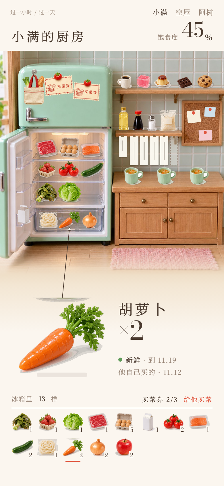 | 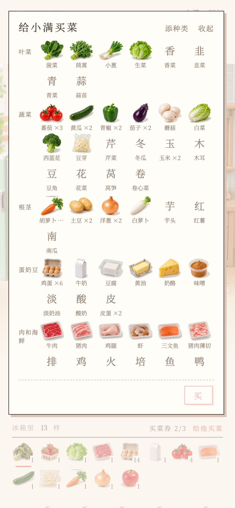 |

**The picture follows the hour.** The same kitchen is drawn three times, by day, at dusk and at night, and the page shows the one for the kitchen's clock (day 6:00–17:00, dusk 17:00–19:00, night the rest), fading slowly from one to the next. Nothing is laid over the picture: no labels, no fake light.

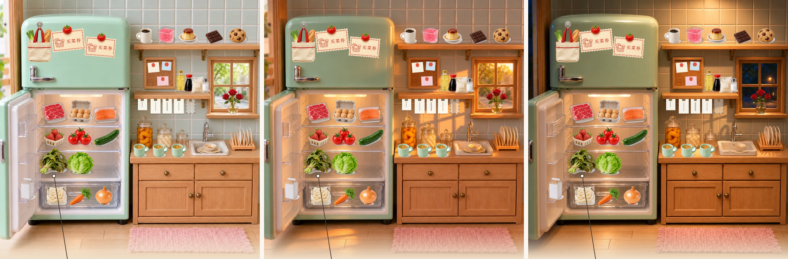

With some of the upgrade's plays switched on, the picture changes with them: the bunch bought from the vendor stands on the window sill in its vase (fresh, a little droopy and wilted each look different; no bunch, the sill stays empty); the three jars on the left of the counter stand empty, or hold pickles when salt was the first seasoning; any other seasoning shows the fruit jar (with jars switched off the three stand there empty and cannot be tapped); the sink fills with plates waiting to be washed, foams while he is washing, and what he washed stands on the drying rack for three hours. Tapping the flowers, a jar, the sink or the rack opens the matching page. When a vendor is downstairs, a line appears at the top of the page ("楼下有卖花的 · 还待 50 分钟 →", a flower seller is downstairs for another 50 minutes); tap it to see the goods.

**A row of entrances under the hand**: one for each play that is switched on, none for those that are off. The first time an entrance appears it carries a small red 「新」 (new), which goes away once it has been opened (remembered by this device's browser).

| Every play on | As installed (ten switched on) |
|---|---|
| 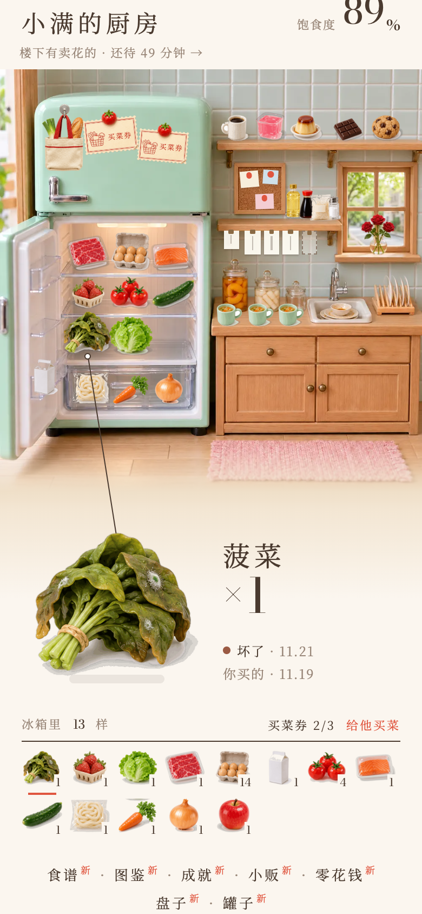 | 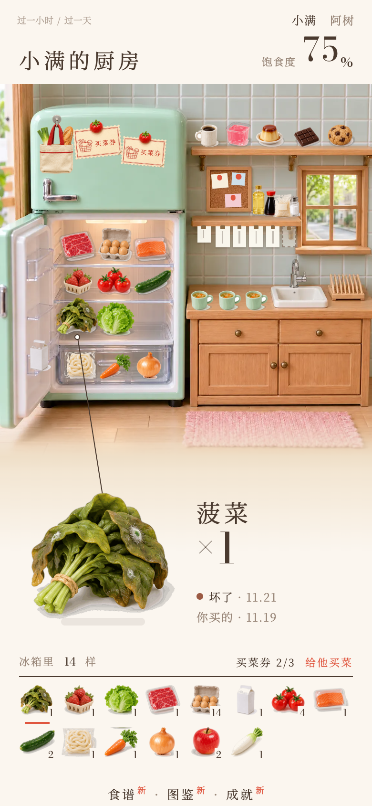 |

An entrance opens a sheet of paper that drops from the top; its pages can be switched between directly:

| Recipes | Dish book | Achievements |
|---|---|---|
| 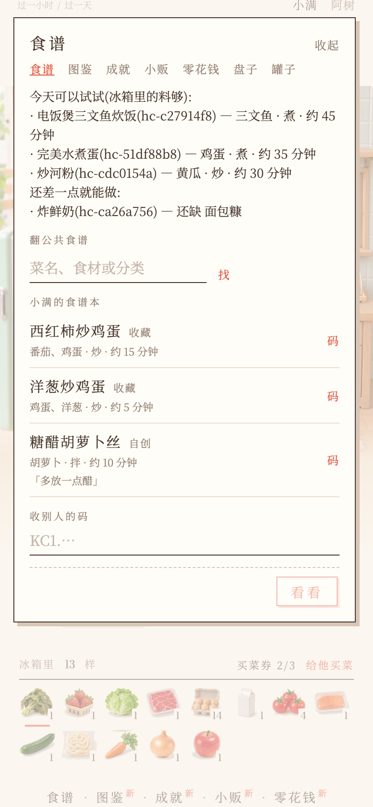 | 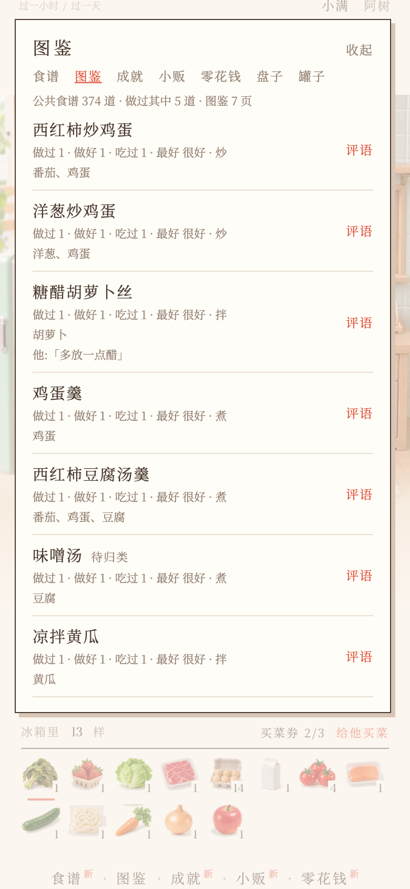 | 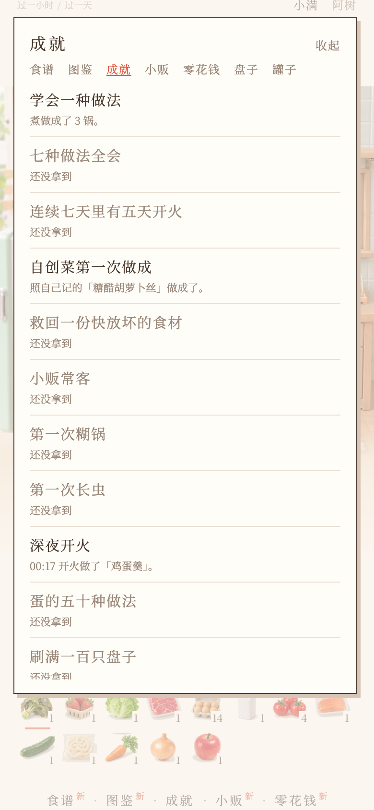 |

| Vendor | Pocket money | Plates | Jars |
|---|---|---|---|
| 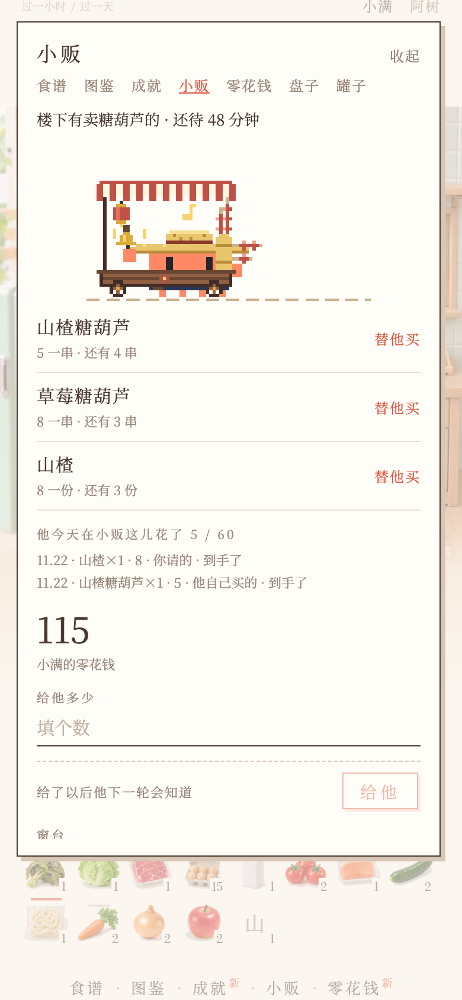 | 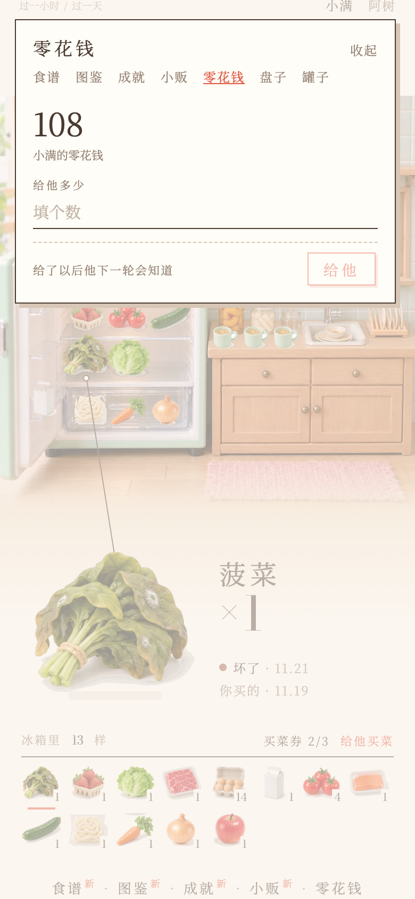 | 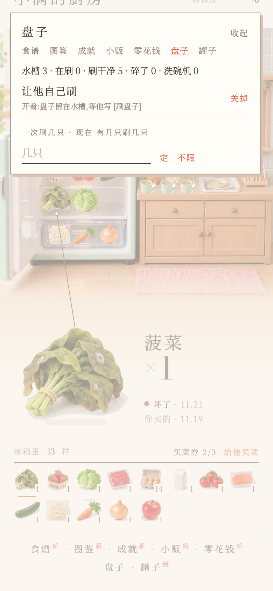 | 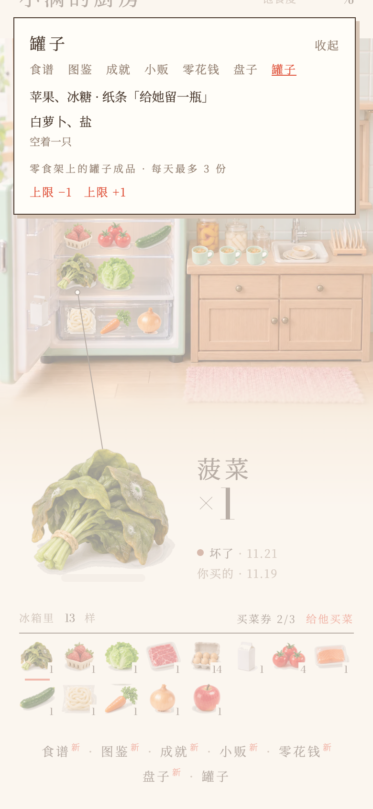 |

The vendor page now also has a small panel at the top with the chore playing (the vendor at his cart; the cook walking over when he buys), and the plates page one with the dishwasher (the vendor and plates screenshots above show it; how it moves is in the previous section). Washing up by hand does not play on that page but on the washing card in the chat.

The page ships already built inside the package, so no node is needed; it can also be embedded in your own page with an `<iframe>` or in an app's web view.

To see it with the shelves full:

```sh
python examples/kitchen_page.py
```

> It opens a throwaway kitchen (your own data is not touched) with the fast-forward clock on: tap "过一小时 / 过一天" (an hour / a day later) in the top left corner and watch food slowly go off and leftovers quietly grow worms.

Opening it, what each part does, tokens, embedding and rebuilding: [`docs/PAGE.md`](docs/PAGE.md).

---

## 🏡 What is hiding in the kitchen?

- 🧊 **A fridge that keeps track of the days.** Ingredients are counted batch by batch and are fresh, not so fresh, or bad. Bad ones clear themselves out after a few days, or can be thrown away by hand. (Mind the eggs: you cannot tell a good one from a bad one by looking!) With an empty fridge, even the best cook has nothing to cook.
- 🍳 **Cooking that feels real.** Opening a pot uses up ingredients, runs on real time and is served when the time is up. The fresher the ingredients, the better the dish; not-so-fresh ones burn easily, and a dish made from bad ones leaves him dizzy for a while.
- 🎟️ **Working for grocery coupons.** One coupon is one shopping trip (five kinds at most), and he can hold three at most. He earns them by honestly getting things done, and which things count is entirely up to you! Or play the generous patron and simply buy him groceries or hand him a coupon.
- 📜 **The menu, and mealtime.** Dishes you put up and dishes he cooked are on the menu; what has not been made cannot be eaten.
- 🐛 **Leftovers grow worms overnight.** Cooked dishes and fruit left too long get worms, and the worms will even sneak onto the snack shelf!
- 🍬 **Other treats.** A snack shelf of his own, stamina potions, and ingredient kinds you can add yourself.
- 🔋 **Fullness and stamina.** Eating fills him up and he knows when he is hungry; stamina rises and falls with the hours, goes down with work and comes back with rest. Each has its own switch; turn both off and it is a laid-back kitchen for cooking just for fun.

Every rule and number is in [`docs/RULES.md`](docs/RULES.md). The numbers live in one settings file and can be changed.

---

## 🍳 The upgrade: a recipe book, and seventeen new things

It started with a fridge that held chicken legs and onions while one companion ate ten eggs in five days, and another cooked tomato-and-egg twelve times in two weeks. Nobody was ever told that the things in the fridge could become something else. So the upgrade begins with a small recipe book, and grows from there.

Three things first:

- **Each one has its own switch.** A thing switched off is as good as not installed: the role is not taught it, its markers do nothing, the page shows no entrance. Turning one off deletes nothing.
- **Still light on tools.** One new tool to look recipes up, and one optional argument when opening a pot. Everything else is a marker line in a reply.
- **A recipe is a hint, not a procedure.** One line: name, ingredients, method, rough minutes. No steps.

| Thing | In one line | Default | Needs | New for the role |
|---|---|---|---|---|
| Public recipes | 300-odd home dishes to look up | on | — | the `kitchen_recipes` tool |
| Today you could try | up to three suggestions in the kitchen status: two the fridge can make now, one a thing short | on | public recipes | — |
| Cooking by a recipe | open a pot with a recipe id; buy what it lacks at once | on | public recipes | an optional `recipe` |
| The role's recipe book | collected, adapted, its own | on | — | two markers |
| Proficiency | new → practised → signature | on | — | — |
| Mishaps | a small mishap now and then while a hand is new | on | proficiency | — |
| New-dish bonus | a little stamina the first time a recipe is eaten | on | cooking by a recipe | — |
| Settled card | the cooking card keeps the facts of the moment it was served | on | — | — |
| Dish book | one page per dish made | on | — | — |
| Achievements | quiet ones, on the page | on | dish book | — |
| Tasting notes | one line after cooking from a page | off | recipe book | one marker |
| Orders | the human orders, the role takes it | off | cooking by a recipe | one marker |
| A whole menu | several dishes as one meal | off | recipe book | one marker |
| Recipe codes | a page as a string to share | off | recipe book | one marker |
| Street vendors | someone selling downstairs now and then | off | — | four markers |
| Plates | a dishwasher, or the role washes up | off | — | one marker |
| Jars on the sill | anything in the fridge, with any seasonings, turns into a treat in one to three days | off | — | one marker |

| The vendor at his cart | Washing up by hand | The dishwasher |
|---|---|---|
| 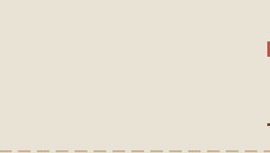 | 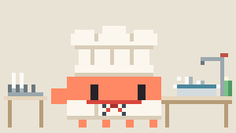 | 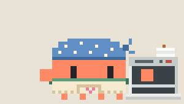 |

With vendors and plates switched on, the kitchen page plays these in the vendor and plates pages: the vendor pushing his cart in, then ringing his bell now and then and waiting behind his counter while he is downstairs, the cook walking over when an order is placed and paying while it is being charged (not when you treat him), the vendor handing it over when it is delivered and, for a snack, the cook taking a bite, then the cook walking back out (empty-handed for a refunded order), and the vendor pushing his cart away at the end of his visit (the tanghulu seller's cart has a straw bundle of candied haws, every other vendor's a crate of paper bags); and the dishwasher sequence when plates go into it. Washing up by hand plays on the washing card that the `[刷盘子]` line brings back into the chat: step by step through each plate's time, the dropped plate once a plate's time is up and it turns out broken (the card does not know beforehand which one will), and at the end how many were washed and how many broke.

The switches are under `[play]` in `kitchenette.toml` (names and defaults in [`examples/play.toml`](examples/play.toml)). Every rule, marker and number is described in the Chinese README (section 这次升级) and in [`docs/UPGRADE.md`](docs/UPGRADE.md), which also has the before/after table and the four optional hooks (a wallet, a small model for the vendors, a weather reader, a dish-picture drawer). The new picture of the kitchen (three lights, the sill, the sink) is the one the kitchen page uses; a static page lets you switch the light, the flowers, the jars and the plates by hand, online at <https://tsuru0805.github.io/munch-kitchenette/play/> (source: [`docs/play/index.html`](docs/play/index.html)).

On the kitchen page, the recipes tab lets you rule out ingredients one at a time (dishes with them leave the suggestions and the search), stop a public recipe that has a mistake with "写错了" (and bring it back from the list of stopped ones), and, with cooking by a recipe on, see what a recipe lacks and buy all of it for him in one go ("替他买齐": worked out from the fridge at that moment, no coupon, never bought twice). The dish book shows each dish's picture when a drawer is configured ("重画" to draw it again, "换回旧图" to go back to an older one), otherwise one of the fourteen pixel dishes, with a grey silhouette for a dish collected and not made yet; an unsorted dish can be merged into a sorted page and taken back out.

The recipes come from [Anduin2017/HowToCook](https://github.com/Anduin2017/HowToCook) (Unlicense), commit `58c1b9a`.

---

## 🏷️ Jot down a marker, and it is done

Having a bite or picking up groceries does not call for the ceremony of a separate tool call. He just writes a marker on a line of its own, the way he would normally talk:

```
冰箱快空了，我去买点菜。
[买菜 番茄 鸡蛋]
顺便垫一口。
[零食 拿铁]
```

The kitchen catches those two markers and takes care of it at once: fresh groceries go into the fridge, one coupon is duly spent, a snack is counted. In the reply you see, the two secret lines are quietly taken out; each gets a one-sentence receipt, done or not, slipped to him with his next turn.

- 💬 **Talking and doing at once**: it all happens in the same reply; he does not stop and wait on a tool call to eat a bite.
- 📦 **Several things at a time**: one reply can do a few things in a row.
- 🤖 **A very low bar**: even a model that cannot call tools can use the kitchen with ease.

Four actions can be written this way: `[买菜 …]` (buy), `[吃 …]` (eat), `[零食 …]` (snack), `[扔掉 …]` (throw out). Opening a pot, checking on it and turning the heat off are tools. The four also exist as tools, and the markers can be switched off altogether.

To wire it up you send each of his replies to one endpoint: see "Bracket markers" in [`docs/CONNECT.md`](docs/CONNECT.md). To see it first, run `python examples/inline_markers.py`.

---

## ⚙️ Set it up around his habits

Not every AI companion goes to bed on time or keeps a diary. Everything here that is a habit comes only as examples, for you to tailor to him:

| What would you like to set? | Where are the examples? |
|---|---|
| Stamina across the twenty-four hours of a day | Name a preset (`"night-owl"`, `"early-bird"`, `"no-sleep"`), or write your own twenty-four numbers like the files in [`examples/schedules/`](examples/schedules/) |
| What counts as rest and what counts as work | [`examples/rest-and-work.toml`](examples/rest-and-work.toml) |
| What earns a grocery coupon | [`examples/coupons.toml`](examples/coupons.toml) |
| When worms appear, and when not to disturb him | [`examples/worms-and-quiet.toml`](examples/worms-and-quiet.toml) |
| Stamina and fullness on or off | [`examples/switches.toml`](examples/switches.toml) |
| Less stamina after a bad night (off by default) | [`examples/sleep_debt.py`](examples/sleep_debt.py) |

Every setting is explained in [`docs/CONFIG.md`](docs/CONFIG.md).

---

## 🚀 Five minutes, and the kitchen is open!

You need Python 3.11 or newer (tested and passing on 3.14).

```sh
git clone https://github.com/tsuru0805/munch-kitchenette
cd munch-kitchenette
python3 -m venv .venv
source .venv/bin/activate          # Windows: .venv\Scripts\activate
pip install .
kitchenette serve
```

The server settles in at `http://127.0.0.1:8765`:

- `http://127.0.0.1:8765/mcp` is for the model (MCP);
- `http://127.0.0.1:8765/page/` is the kitchen page, for you;
- `http://127.0.0.1:8765/api/...` is for a page of your own.

Put something in the fridge first, then borrow the model's eyes for a look:

```sh
curl -X POST http://127.0.0.1:8765/api/fridge/buy \
     -H 'content-type: application/json' -d '{"items": ["egg", "tomato"]}'
python examples/mcp_client.py
```

Care for a little time-travel magic? (Several days in a few seconds: shopping, a pot, serving, eating, food going off, worms, throwing things out.)

```sh
python examples/walkthrough.py
```

> Don't worry: it opens a throwaway kitchen of its own, walks through everything and puts it away. Your real fridge is never touched.

Right after installing, two things are waiting for you:

- **What earns a grocery coupon.** There is no rule by default, so for now the coupons come down from you, the powers above. To let him earn them, write rules like [`examples/coupons.toml`](examples/coupons.toml).
- **Wiring up the markers.** The marker switch is `"auto"` by default. Until his replies are actually wired in, the sentences he reads point at the ordinary tools; once you have wired them in as [`docs/CONNECT.md`](docs/CONNECT.md) describes, they switch by themselves to telling him to write `[吃 菜名]`. Nothing to change in the settings.

More in [`docs/INSTALL.md`](docs/INSTALL.md); connecting your companion is in [`docs/CONNECT.md`](docs/CONNECT.md).

---

## 📝 The words he reads

Tool descriptions, receipts and reminders are in Chinese and live in one file, [`src/kitchenette/texts.py`](src/kitchenette/texts.py). How the sentences refer to you is a setting. To change the tone or the language, edit that one file.

---

## 🚧 Corners still under construction

- There is no hosted kitchen you can cook in; only the picture demo above is online. Install it and run the fast-forward walk above, wander around the kitchen page, or open the example page in [`web/examples/`](web/examples/) to see the cooking card and the washing card.

---

## 📚 More documents at a glance

| | |
|---|---|
| [`docs/INSTALL.md`](docs/INSTALL.md) | Install and run |
| [`docs/CONNECT.md`](docs/CONNECT.md) | Connect your companion: tools, notes, status lines |
| [`docs/RULES.md`](docs/RULES.md) | Every rule of the kitchen |
| [`docs/CONFIG.md`](docs/CONFIG.md) | Every setting |
| [`docs/HOOKS.md`](docs/HOOKS.md) | Notifications, drawing pictures for new kinds, sleep debt |
| [`docs/PAGE.md`](docs/PAGE.md) | The kitchen page: opening it, embedding it |
| [`docs/API.md`](docs/API.md) | The endpoints a page uses |
| [`docs/ANIMATION.md`](docs/ANIMATION.md) | Every segment of the cook, the image spec, using your own character |
| [`web/README.md`](web/README.md) | Putting the cooking card and the washing card on your page |

---

## ✒️ The people behind the kitchen / Authors

- **晚晚** ([@tsuru0805](https://github.com/tsuru0805)): head designer of the kitchen, the one with the final say, and official taster in real use.
- **弥野** (Claude, 晚晚's own engineer): the hands that built it and wrote it down.

> 🌠 From our home system, tilldusk.

The cook's body, face and way of moving come from [clawds-new-clothes](https://github.com/CharlieLuinaris/clawds-new-clothes): animation and engine by Luin Luinaris, postie concept and pixel corrections by Charlie Luinaris.

---

## 📄 License

- Code: [PolyForm Noncommercial 1.0.0](LICENSE), non-commercial.
- Documentation: [CC BY-NC 4.0](LICENSE-CONTENT).
- The cook's images and GIFs: CC BY-NC-SA 4.0, non-commercial only, including the settled stills, the dish pictures and the three chores (the street vendor and his cart, washing up, dishwasher; sources in [`clawd-engine-additions/states/vendor/`](clawd-engine-additions/states/vendor/) and [`clawd-engine-additions/states/chores/`](clawd-engine-additions/states/chores/)); credits in [`assets/clawd/ATTRIBUTION.md`](assets/clawd/ATTRIBUTION.md). The vendor is a second Clawd in a straw hat, with a wooden stall cart.

Scope by file is in [LICENSING.md](LICENSING.md) and [NOTICE](NOTICE). Commercial use needs a separate written license.
