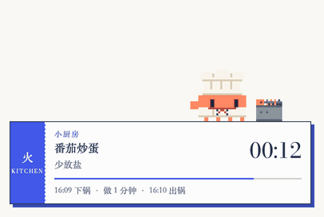
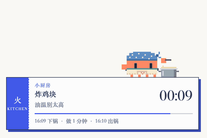
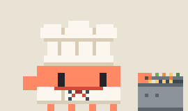
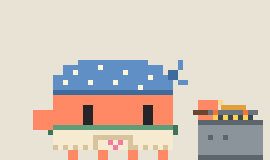
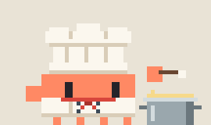
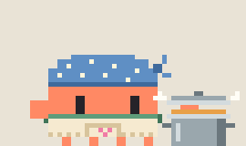
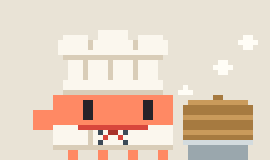
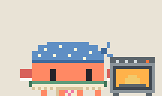
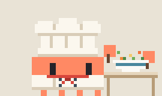
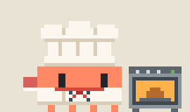

# 🍳 munch-kitchenette (吧唧吧唧小厨房)

[English](README.en.md)

**为你的小机，搭建一间充满烟火气的专属小厨房吧！✨**

冰箱里的菜会随着日子悄悄变得不新鲜；想吃上一口热饭，得耐下心来等待真实的时间流逝；想要买菜？那得靠他自己乖乖做事去攒「买菜券」啦。你可以随时给他买点小菜、挂上一道心仪的菜谱，或者投喂一口小零食；而他也会自己学着开锅、守着火候、关火盛饭，甚至把坏掉的食物偷偷扔掉。

它不仅仅是个玩具，还是一个能独立运行的轻巧小服务：所有的生活规则和厨房账本都妥帖地存在一个文件里。**任何支持 MCP 的模型，都能随时连上来，吃上一口热饭。**

> 💡 **小彩蛋**：图例里的小厨师是 Clawd —— Anthropic 为 Claude Code 创作的角色。这是非官方同人作品，与 Anthropic 没有隶属关系，也没有得到其赞助或背书哦。

---

## 🧑‍🍳 卡片上的小厨师

开锅之后，聊天界面会浮现一张做饭卡，跟着真实的时间滴答倒数。小厨师会站在卡片的上沿卖力干活，直到把热气腾腾的菜端出来——当然，偶尔也会失手做糊（笑）。

| 完美出锅 ✨ | 哎呀，糊了 💥 |
|---|---|
|  |  |

他会认认真真照着这道菜的做法来料理。七种烹饪方式，各有各的顺手家伙和招牌动作，衣服也有两套（不过为了不穿帮，同一锅从头到尾都会穿同一套哦）。

| 炒 | 煎 | 炸 | 煮 | 蒸 | 烤 | 拌 |
|---|---|---|---|---|---|---|
|  |  |  |  |  |  |  |

**他的烹饪时间表是这样的：**

| 正在做什么 | 什么时候发生 |
|---|---|
| 💧 **洗手** | 只有刚下锅的时候洗一次。不到 3 分钟的“快手菜”就免洗啦。 |
| 🔪 **切菜** | 占据烹饪时长的前 20%（最多切 5 分钟）。 |
| 🍳 **主动作** | 中间热火朝天的大段时间，根据做法不同而变化。 |
| 💦 **小动作** | 主动作期间偶尔来一下：擦擦汗、抬头看看你，或者被热气熏到。每 30 秒里会有一个 3 秒的小窗口。 |
| 🥄 **尝味** | 最后 10% 的收尾阶段（最多尝 2 分钟）。 |
| 🍽️ **端出美味** | 到点了！这一锅做得「很好」或「普通」。 <br> |
| 💨 **冒着黑烟** | 到点了... 这一锅「糊了」或「坏了」，端出一盘黑炭。 <br> |

每一段动画都是从下锅时刻和总时长现算出来的。所以，无论你是把卡片滚出屏幕、刷新页面，还是换一台设备打开，他都会精准地出现在这一刻该在的地方，一天都不会偷懒。

做饭卡是一个不依赖任何前端框架的原生元素 `<kitchenette-cooking-card>`，只要放一个标签就能用：具体见 [`web/README.md`](web/README.md)。想了解每一段的细节、素材规格、或者想换成你自己的专属小人：请见 [`docs/ANIMATION.md`](docs/ANIMATION.md)。

---

## 🏡 厨房里都藏着什么？

- 🧊 **会过日子的冰箱**：食材一批一批算日子，分为“新鲜、不太新鲜、坏了”三档。坏掉的食物放几天会自己清走，也可以手动扔掉。（注意：鸡蛋从外面可是看不出好坏的哦！）如果冰箱空了，小厨师可就巧妇难为无米之炊了。
- 🍳 **真实的做饭感**：开锅时消耗食材，按真实时间计时，到点出锅。食材越新鲜，越容易做出好菜；不太新鲜的容易糊锅，要是用了坏食材，吃完可是会头晕一阵子的。
- 🎟️ **打工赚买菜券**：一张券买一次菜（一次最多买五样），手里最多只能攒三张。券要靠他自己踏踏实实做事来换，至于“做什么事算数”，全由你来定！你当然也可以霸道总裁上身，直接给他买菜或发券。
- 📜 **菜单与开饭**：你挂的菜、他做好的菜都在菜单上；没做出来的东西是吃不到的。
- 🐛 **放过夜会长虫**：做好的饭菜和水果如果放太久会长虫，虫子甚至还会悄悄钻进零食架！
- 🍬 **其他福利**：有专属零食架、精力补充药剂，还可以自己手动添加食材种类。
- 🔋 **饱食度与体力**：吃了会饱、饿了他自己知道；体力也会跟着时间起伏，干活扣体力、休息回体力。这两个机制各有一个开关，如果都关掉，那就是个纯粹用来“做饭玩”的休闲厨房啦。

每条详细规则和数值请翻阅 [`docs/RULES.md`](docs/RULES.md)。所有的数值都集中在一份配置里，随时可以调整。

---

## ⚙️ 照着他的习惯来布置

不是每一个小机都会乖乖睡觉或写日记。在这里，所有关于「习惯」的设定都只提供例子，完全由你自己来为他量身定制：

| 你想配点什么？ | 例子写在哪里？ |
|---|---|
| **体力作息** (一天24小时的起伏) | 直接填预设名字（夜猫 `"night-owl"`、早睡早起 `"early-bird"`、不睡觉 `"no-sleep"`），或照 [`examples/schedules/`](examples/schedules/) 自己填二十四个数。 |
| **劳逸结合** (什么算休息、什么算干活) | [`examples/rest-and-work.toml`](examples/rest-and-work.toml) |
| **打工换券** (做什么事能换一张买菜券) | [`examples/coupons.toml`](examples/coupons.toml) |
| **长虫与免打扰** (几点长虫、什么时段别吵他) | [`examples/worms-and-quiet.toml`](examples/worms-and-quiet.toml) |
| **硬核生存开关** (体力、饱食度开不开) | [`examples/switches.toml`](examples/switches.toml) |
| **睡眠债** (没睡好第二天体力打折，默认关) | [`examples/sleep_debt.py`](examples/sleep_debt.py) |

配置每一项的具体说明，请见 [`docs/CONFIG.md`](docs/CONFIG.md)。

---

## 🏷️ 顺手写个标签，事就办了

想让他吃口饭、买把菜，根本不用兴师动众地单独调一次工具。他只要在回复里像平时说话一样，单独写一行标签就行：

```text
冰箱快空了，我去买点菜。
[买菜 番茄 鸡蛋]
顺便垫一口。
[零食 拿铁]
```

厨房捕捉到这两行标签，立刻就把事办妥啦：新鲜食材塞进冰箱、乖乖扣除一张券、零食罐里记上一份美味。给你看的最终回复里，这两行“暗号”会被默默拿掉；事情办成没办成，各有一句回执，会在下一轮悄悄带给他。

- 💬 **说话和做事同步**：都在同一条回复里，不用为了吃一口饭特意停下来等一次工具调用。
- 📦 **支持批量操作**：一条回复里可以连着办好几件事。
- 🤖 **门槛超低**：哪怕是不会调用工具的模型也能轻松使用。

目前支持写成标签的动作有四个：`[买菜 …]`、`[吃 …]`、`[零食 …]`、`[扔掉 …]`。（开锅、看锅、关火则依然走工具调用）。这四样动作也都有对应的常规工具，如果你不喜欢用标签，完全可以把它关掉。

具体的接法是将他的每条回复送进一个接口，详见 [`docs/CONNECT.md`](docs/CONNECT.md) 的「方括号标签」一节；想先看一眼效果，可以直接跑 `python examples/inline_markers.py`。

---

## 🚀 只需五分钟，厨房开张！

环境需要 Python 3.11 或更新的版本（已在 3.14 上测试通过）。

```sh
git clone https://github.com/tsuru0805/munch-kitchenette
cd munch-kitchenette
python3 -m venv .venv
source .venv/bin/activate          # Windows: .venv\Scripts\activate
pip install .
kitchenette serve
```

服务会稳稳地跑在 `http://127.0.0.1:8765`：

- `http://127.0.0.1:8765/mcp` （给模型连接使用的 MCP 接口）
- `http://127.0.0.1:8765/api/...` （给页面调用的接口）

可以先往冰箱里放点东西，再借用模型的“眼睛”看一眼：

```sh
curl -X POST http://127.0.0.1:8765/api/fridge/buy \
     -H 'content-type: application/json' -d '{"items": ["egg", "tomato"]}'
python examples/mcp_client.py
```

想体会一下“快进时间”的魔法？（几秒钟内看完好几天的买菜、开锅、出锅、吃、放坏、长虫、扔掉）：

```sh
python examples/walkthrough.py
```

> 放心，它会自己起一间临时厨房走完流程就收掉，绝对不会弄乱你真实的冰箱。

刚装好的时候，有两件事等你来布置：

- **做什么换买菜券**：默认没有规则，券先由你这个“天神”手动发。想让他靠做事换，请照着 [`examples/coupons.toml`](examples/coupons.toml) 写。
- **把标签接上**：标签开关默认是「自动」。在还没把他的回复正式接进来之前，他读到的提示会先指向常规工具；等你照 [`docs/CONNECT.md`](docs/CONNECT.md) 接好之后，它自己会聪明地换成教他写 `[吃 菜名]`，不用你再动配置。

详细的安装说明见 [`docs/INSTALL.md`](docs/INSTALL.md)，怎么接上你的专属小机请看 [`docs/CONNECT.md`](docs/CONNECT.md)。

---

## 📝 给他看的字

工具说明、回执、提醒全都是中文，清清爽爽地集中在 [`src/kitchenette/texts.py`](src/kitchenette/texts.py) 这一个文件里。句子里他该怎么称呼你，可以在配置里直接填。如果想换语气、换语言，改这一个文件就够了。

---

## 🚧 还在施工中的小角落

- **厨房前端页**（专门给你用的那一页，包括视察冰箱、零食架、桌上的菜、买菜等）正在紧锣密鼓地重做中，做好后就会加进来！在那之前，人类这一侧的操作（买菜、发券、挂菜、喂零食）需要委屈一下走 `/api` 接口，见 [`docs/API.md`](docs/API.md)。
- 目前没有在线试玩。装起来以后可以用上面的“快进脚本”走一遍，或者打开 [`web/examples/`](web/examples/) 里的例子页，欣赏一下做饭卡。

---

## 📚 更多文档速查

| 在哪里找？ | 想看什么？ |
|---|---|
| [`docs/INSTALL.md`](docs/INSTALL.md) | 安装与运行指南 |
| [`docs/CONNECT.md`](docs/CONNECT.md) | 接上你的小机：工具说明、带给他的话、以及每轮状态行 |
| [`docs/RULES.md`](docs/RULES.md) | 厨房里的每一条过日子规则 |
| [`docs/CONFIG.md`](docs/CONFIG.md) | 每一项配置的详细解释 |
| [`docs/HOOKS.md`](docs/HOOKS.md) | 到点通知、小图现画、缺觉这几个口子该怎么接 |
| [`docs/API.md`](docs/API.md) | 页面端使用的接口 |
| [`docs/ANIMATION.md`](docs/ANIMATION.md) | 小厨师的每一段动画、素材规格、怎么换成你自己的小人 |
| [`web/README.md`](web/README.md) | 怎么把做饭卡优雅地放进你的页面 |

---

## ✒️ 厨房主理人 / Authors

- **晚晚**（[@tsuru0805](https://github.com/tsuru0805)）—— 厨房总设计、一锤定音的拍板人、以及真场试吃验收官。
- **弥野**（Claude，晚晚的专属工程手）—— 负责搬砖实现与文档整理。

> 🌠 出自我们的家用系统 tilldusk。

小厨师的身体、表情和动态表现来自 [clawds-new-clothes](https://github.com/CharlieLuinaris/clawds-new-clothes)：动画与引擎作者为 Luin Luinaris，信差设定与像素修订为 Charlie Luinaris。

---

## 📄 许可协议

- 代码：[PolyForm Noncommercial 1.0.0](LICENSE)，非商用。
- 文档：[CC BY-NC 4.0](LICENSE-CONTENT)。
- 小厨师的图与动图：CC BY-NC-SA 4.0，仅限非商业使用，署名请见 [`assets/clawd/ATTRIBUTION.md`](assets/clawd/ATTRIBUTION.md)。

逐项范围详见 [LICENSING.md](LICENSING.md) 与 [NOTICE](NOTICE)。商业用途需要另行书面授权。
