# The cook on the card

[中文在下面](#卡上的小厨师)

When your companion starts a pot, a card appears in the chat and counts down in real time. A small cook stands on the card's top edge and actually cooks: washes his hands, chops, works the pan, tastes, and brings the dish out when the time is up. Or burns it.

| A pot that turns out well | A pot that burns |
|---|---|
|  |  |

> **Unofficial fan work.** The cook is Clawd, a character created by Anthropic for Claude Code; all rights in the character and in the names "Clawd", "Claude", "Claude Code" and "Anthropic" belong to Anthropic, PBC. This project is not affiliated with, sponsored by or endorsed by Anthropic. The cook is drawn with the engine of [clawds-new-clothes](https://github.com/CharlieLuinaris/clawds-new-clothes) (animation and engine by Luin Luinaris, postie concept and pixel corrections by Charlie Luinaris); the chef outfits and cooking moves are additions made for this project. The images are CC BY-NC-SA 4.0, non-commercial only. Full credits: [`assets/clawd/ATTRIBUTION.md`](../assets/clawd/ATTRIBUTION.md).

## One pot, from start to finish

Every clip is 3 seconds long (45 frames) and starts from the same standing pose, so any clip can follow any other without a jump.

| Segment | What he does | When it plays |
|---|---|---|
| entrance | Rises from behind the card's top edge with a small bounce. | Once, when the page first sees a pot that started within the last 5 minutes. |
| `wash` <br> | Washes his hands in a basin and shakes them dry. | Once, for 3 seconds, right as he comes on. Skipped for dishes shorter than 3 minutes, and never replayed when the card is shown again. |
| `chop` <br>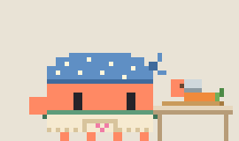 | Chops a carrot on a board. | The first 20% of the cooking time, at most 5 minutes. |
| `<method>_main` | The main action of the cooking method (see the table below), looping. | From the end of the chopping until the tasting. |
| `<method>_wipe` <br> | Wipes his brow. | A small action. In every 30 seconds of the main part there is one window (seconds 12 to 15). In it he does one of the three small actions, or nothing; which one depends on the pot and on which 30 seconds it is, so the same moment always shows the same thing. |
| `<method>_look` <br> | Looks up from the pot, blinks at you and waves. | A small action, as above. |
| `<method>_hot` <br> 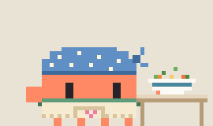 | Gets a face full of steam and flinches. Mixing has no heat, so there he sneaks a bite instead. | A small action, as above. |
| `<method>_taste` <br> | Tastes a spoonful and adds seasoning. | The last 10% of the cooking time, at most 2 minutes. |
| (waiting) | Keeps doing the main action. | After the time is up, until the backend says how the pot turned out (at most 6 seconds; after that it counts as an ordinary pot). He never serves first and then changes his mind. |
| `<method>_serve` | Plates the dish and holds it up. | The pot turned out `great` or `ok`. The clip plays once, the last frame (`<method>_serve_last`) is held for 2 seconds, then he sinks back behind the card. |
| `<method>_fail` | Smoke; he holds up something black. | The pot turned out `burnt` or `spoiled`. Same timing, with `<method>_fail_last` as the held frame. |
| heat off | Sinks back behind the card while still doing the main action; carries nothing out. | The pot was cancelled while the card was on screen. |
| after | No cook. The card reads "served" with the outcome, or "heat off". | From then on, and for any card that is shown for the first time after its pot was already due. |
| `base` | Stands still. | Instead of the clips when the visitor asked for reduced motion, when the page is in the background, or when more than two cooks would be moving at once (the two newest cards move). |

## Seven methods, two outfits

The method comes from the backend with the pot (`stirfry`, `fry`, `deepfry`, `boil`, `steam`, `bake`, `mix`; anything else plays as `stirfry`). The outfit is picked from the pot's id, so one pot keeps one outfit from start to finish and both turn up over time: `toque` is a tall chef's hat, a white double-breasted jacket and a red neckerchief; `scarf` is a blue polka-dot headscarf and a cream apron with a pink heart pocket.

| Method | Main action | `toque` | `scarf` | Served | Burnt |
|---|---|---|---|---|---|
| `stirfry` 炒 | Tosses the pan over the flame. |  | 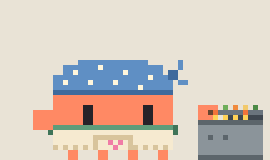 |  |  |
| `fry` 煎 | Watches the pan spit, slides the spatula under and flips. | 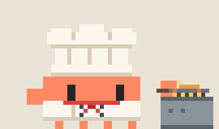 |  | 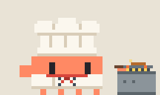 | 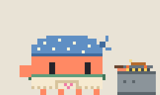 |
| `deepfry` 炸 | Lowers a piece into the oil with long chopsticks and lifts it out golden. |  | 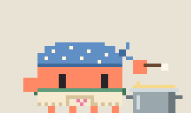 |  | 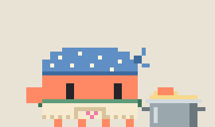 |
| `boil` 煮 | The lid rattles; he lifts it and leans into the steam. |  |  |  | 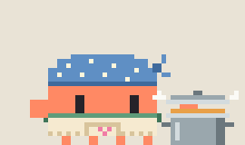 |
| `steam` 蒸 | Minds a bamboo steamer and lifts the lid on three white buns. |  |  |  |  |
| `bake` 烤 | Crouches at the oven window in mitts while the loaf browns. | 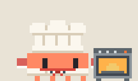 | 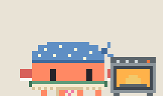 |  | 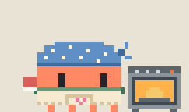 |
| `mix` 拌 | No heat: tosses a big bowl with two servers. |  | 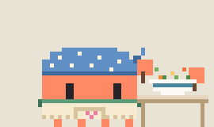 |  |  |

The pictures here show one outfit per column to keep the page light; every clip exists in both outfits. To look at all of them, open [`web/examples/gallery.html`](../web/examples/gallery.html) (see [`web/README.md`](../web/README.md) for how to open the example pages).

## What keeps it steady

- **Nothing is remembered, everything is recomputed.** The segment is a function of the pot's start time, its duration, the current time and what the backend said. Scroll the card away and back, or reload the page, and he is where he should be at that moment.
- **The entrance and the hand-washing happen once.** Showing the card again does not replay them, and a pot started hours ago does not get an entrance at all.
- **A card from history never comes back to life.** If the pot was already due when the card appeared, the card shows the finished state with no cook.
- **One-shot clips end on a still image.** After a serve or fail clip has played, the card swaps it for a PNG of its last frame, so it does not depend on how a browser loops animated images.

The rules live in two small files of pure functions, [`web/src/cookPhase.ts`](../web/src/cookPhase.ts) and [`web/src/cookSegments.ts`](../web/src/cookSegments.ts), each with its tests next to it.

## Chores

Three more sets of clips come from the same pack, in the same two outfits, and follow the card's outfit rule: a washing wears `outfits[hash(washing id) % 2]`, an order its order id's. Washing up by hand plays where the cooking plays: on a card of its own in the chat, the washing card `<kitchenette-washing-card>` (see [`web/README.md`](../web/README.md#the-washing-card)), with the cook on its top edge; he rises from below the card when the page first sees the washing, once the backend has answered. Buying from the vendor and loading the dishwasher play on the kitchen page ([`PAGE.md`](PAGE.md)), in a small panel at the top of its "vendor" and "plates" pages; the plates page has only the dishwasher. Nothing is drawn onto the kitchen picture. The vendor's clips are scenes with a second Clawd, the vendor himself (a straw hat and an indigo jacket), behind the counter of his wooden cart; when the role buys, the cook stands at the side of the cart. The tanghulu seller's cart has a straw bundle of candied haws on the counter (`vendor_th_<part>`), every other vendor's a crate of paper bags (`vendor_<part>`); the clips with the vendor alone are the same in both outfits.

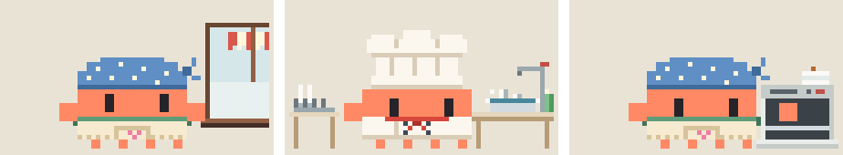

| Segment | What he does | When it plays |
|---|---|---|
| `vendor_arrive` | The vendor pushes his cart in from the right, walking behind it, stops, and turns to face out (once). | The first time this device shows the visit (kept while the page is open), for 3 seconds, before anything else (an order already under way waits for it). |
| `vendor_call` / `vendor_wait` | Rings a hand bell, eyes shut, notes rising from his hat / stands behind his counter looking up and down the street. | For as long as he is there and nothing else plays: `call` for 3 seconds every 15 seconds, `wait` in between. |
| `vendor_walkin` | The cook walks in from the right to the side of the cart, stops and turns; the vendor turns to him and nods (once). | When the role's order is placed (a treat too), once his arrival and any earlier order have been played; the order's other clips follow it. `vendor_walkin_last` is the cook standing at the cart while a treat is still on its way. |
| `vendor_pay` | The cook at the side of the cart lifts two coins; they hop one by one into the vendor's hand, he puts them away under the counter and nods. | After the cook has walked over, while the order is created, being charged or paid, and at least one clip even if it went through faster. Not for an order the human treats him to (it costs him nothing). |
| `vendor_give` → `vendor_eat` | The vendor takes one from his counter (a candied-haw skewer from the straw bundle, or a paper bag) and hands it straight over; the cook takes it, blushes and hops (once; `vendor_give_last` is its last frame). Then the cook raises it to his face and takes a bite, chews, a heart rises (once; `vendor_eat_last`). | Once the order is delivered and the cook has walked over (and paid): `give` for 3 seconds, then `eat` for 3 seconds if it was a snack, or `vendor_give_last` for as long if not (an ingredient or flowers, which are not eaten on the spot). |
| `vendor_walkout` / `vendor_walkout_hold` / `vendor_walkout_empty` | The cook nods and walks back out to the right carrying the skewer he bit into or the bag / what he bought / nothing; the vendor waves (once). | After `eat` / after holding it / for a refunded or failed order, once, when that is known (nothing is handed over; refunding then refunded plays it once). Then the vendor is alone at his cart again. |
| `vendor_leave` | Turns, puts his hands on the counter and pushes the cart away to the left (once; `vendor_leave_last` is the empty roadside). | From the last 3 seconds of the visit, as soon as no order is on stage: an order already under way is played to its end first (the server goes on returning the visit for a short while after it ends, as `ended`, so the page can; if that stops, the page finishes from what it last read, closing an order not through by then with the cook walking back out empty-handed, and then the panel is empty). Then the empty roadside. An order that turns up while he is leaving or gone (placed in the last seconds, or read late) brings him back: `vendor_arrive` again, the order, `vendor_leave` again. When the next visit is live straight away, the old show still finishes first (its order, that vendor leaving) before the new vendor arrives; the new visit's orders are noted from when the page first read them meanwhile, so they play after his arrival rather than being let go as long done. |
| `dish_sleeve` `dish_soap` `dish_scrub` `dish_rinse` `dish_shake` `dish_dry` `dish_stack` | Rolls up his sleeves, squeezes the soap, scrubs, rinses under the tap, shakes the water off, dries with a towel, stacks it on the rack. | On the washing card, while he washes up: each plate's time (`per_s`) is cut into seven equal parts in this order, each looping. The sleeves are rolled up once, at the start of the washing: `dish_sleeve` plays once (3 seconds), then soap for the rest of that part; from the second plate on the first part is soap too. |
| `dish_break` | The plate slips, bounces, he grabs at it and misses; it breaks on the floor and he scratches his head (once; `dish_break_last` is its last frame). | On the washing card, when a plate's time is up and the server reports it broken. A plate's result is only told once its time is up, so the card never knows beforehand which one will break; while the result is being read the stacking goes on (at most 4 seconds). The clip plays once (3 seconds) from when the card learns it, its last frame for 2 more, then the next plate goes on. A break the card only learns of more than 20 seconds after the plate was due (a card shown again later) is not played. |
| (the end) | Sinks back below the card. | After the last plate (and its dropped plate, if it broke), or from the moment the card learns the washing was stopped midway. The card then reads 刷完了 / 停下了 and, once the backend has said so, how many were washed, broke and went into the dishwasher. A card that first appears after the washing is over shows no cook. |
| `machine_load` → `machine_close` → `machine_start` → `machine_run` → `machine_done` | Puts the plates in, closes the door, presses the button, the machine runs, he opens it in a puff of steam (once; `machine_done_last` is its last frame). | From when a plate last went into the dishwasher: 3 + 3 + 3 seconds, the run for 8 seconds, then done, and its last frame stays. |
| still | `base`; the `_last` frame of `dish_break`, `machine_done`, `vendor_leave`, `vendor_walkin`, `vendor_give`, `vendor_eat`; `vendor_still` (the vendor standing by his cart). | "Reduce motion" (on the washing card also: the page in the background, or more than two cooks would be moving at once): a clip that plays once shows its last frame; any other vendor clip the vendor standing by his cart; any other the standing pose. |

The washing card's rules are pure functions in [`web/src/washSegments.ts`](../web/src/washSegments.ts) (what the card says: [`web/src/washFace.ts`](../web/src/washFace.ts)), with tests next to them; the card reads the washing back from `GET /api/dishes/jobs/<id>`. The rules are in [`web/page/src/kitchen/choreAnim.ts`](../web/page/src/kitchen/choreAnim.ts) with tests next to them: the dishwasher is a pure function of the time; the vendor is a small player per visit (`VendorShow`) that remembers on this device what it has already played, because the server's facts can move faster than the clips (an order paid and delivered within a second, a visit ending while the cook is at the cart). Every act starts when this device starts showing it and is shown in full before the next one starts: time that passed unseen (the page asleep, an answer read late) never counts as played. It plays every step of each order once and in order (walking over, paying when the role pays, at least one clip, handing over, eating or holding, walking back out; or walking back out empty-handed), the role's orders oldest first; it skips only an order that was already done more than 30 seconds before this device first saw it. Shows are kept per server, role and visit (switching role shows that role's own), a few at a time; each remembers its finished orders as one mark, and the page keeps the facts only of the orders still to be played. The server gives what they need (`/api/dishes`: `machine_at`; `/api/vendor`: which vendor, when he leaves (`leave_at`), his goods with their `kind`, the role's orders with `kind`, `state` and `updated_at`, and for a short while after a visit ends, that visit as `ended`; see [`API.md`](API.md)). Only when the vendor arrives is not the server's but this device's: his arrival is rarely watched live, so it plays the first time the page shows the visit. A pack of your own does not need them: the card's registry check reports them separately (`missingChoreKeys`), and without them the panels are simply empty.

## Using your own character

The card does not know about Clawd. It asks a registry "which file is `<outfit>/<segment>`?" and shows that file. Give the element your own registry and folder:

```html
<kitchenette-cooking-card id="pot" assets="/my-sprites/"></kitchenette-cooking-card>
<script type="module">
  document.getElementById("pot").manifest = {
    outfits: ["plain"],                       // one pot wears outfits[hash(pot id) % outfits.length]
    files: {
      "plain/base": "plain/base.png",
      "plain/wash": "plain/wash.webp",
      "plain/chop": "plain/chop.webp",
      "plain/boil_main": "plain/boil_main.webp",
      // ... one entry per segment, for every outfit
    },
  };
</script>
```

The built-in registry, [`assets/clawd/manifest.json`](../assets/clawd/manifest.json), is the model to copy. An outfit needs 66 files:

| Key | Count | File |
|---|---|---|
| `<outfit>/base` | 1 | still image: the standing pose |
| `<outfit>/wash`, `<outfit>/chop` | 2 | animated clips |
| `<outfit>/<method>_<part>` for 7 methods × `main`, `wipe`, `look`, `hot`, `taste`, `serve`, `fail` | 49 | animated clips |
| `<outfit>/<method>_serve_last`, `<outfit>/<method>_fail_last` for 7 methods | 14 | still images: the last frame of the serve / fail clip |

If you only draw some methods, point the other methods' keys at the files you have. A key that is missing altogether leaves the stage empty for that segment. If the pack's folder is not there at all, the card asks for one image, finds nothing and asks for nothing more: without sprites the card only counts down.

Image spec:

| | |
|---|---|
| Format | Animated clips: anything an `` can animate with transparency (the Clawd pack uses lossless animated WebP). Stills: PNG. |
| Canvas | Square, shown at 180 × 180 CSS pixels. The Clawd pack is 720 × 720. |
| The line | The row at 560 / 720 of the height (7/9 of the way down) sits exactly on the card's top edge. Everything above it is visible; everything below is cut off, and only shows for an instant when he bounces in. Stand the character and the counter on that line, and let bodies and pot bottoms continue a little below it. |
| Length | 3 seconds per clip. The timing rules assume it. |
| First frame | The same standing pose in every clip (and equal to `base`), so changing clips does not jump. |
| Loops | `main`, `chop` and `taste` loop for as long as their part lasts and should loop seamlessly. `wash`, the three small actions, `serve` and `fail` are shown for 3 seconds only. |
| Movement | Do not bake the entrance or the exit into the clips: the card slides the whole canvas itself. |
| Last frames | `_serve_last` / `_fail_last` are the final frame of the matching clip, pixel for pixel. |

## Where things are

| | |
|---|---|
| [`assets/clawd/`](../assets/clawd/) | The sprite pack: `toque/` and `scarf/` (120 files each: the 66 the card needs, 9 settled stills, 45 chore clips and stills), `dishes/`, `manifest.json`, the attribution and the licenses. |
| [`clawd-engine-additions/`](../clawd-engine-additions/) | The outfits and moves (the chores in `states/chores/`, the vendor in `states/vendor/`) as source files for the clawds-new-clothes engine, and how to export the pack again. |
| [`web/`](../web/) | The cards: the `<kitchenette-cooking-card>` and `<kitchenette-washing-card>` elements, their example pages and tests. |
| [`docs/animation/`](animation/) | The GIFs on this page (made from the pack by `docs/animation/tools/make_gifs.py`). |

---

# 卡上的小厨师

他开锅之后，聊天里会出现一张做饭卡，按真实时间倒数。卡的上沿站着一个小厨师，真的在做这顿饭：洗手、切菜、守着锅、尝味道，到点把菜端出来。也可能做糊。

| 做好的一锅 | 糊了的一锅 |
|---|---|
|  |  |

> **非官方同人作品。** 小厨师是 Clawd——Anthropic 为 Claude Code 创作的角色；角色形象以及「Clawd」「Claude」「Claude Code」「Anthropic」这些名称，一切权利归 Anthropic, PBC。本项目与 Anthropic 没有隶属关系，没有得到其赞助或背书。小厨师用 [clawds-new-clothes](https://github.com/CharlieLuinaris/clawds-new-clothes) 的引擎画成（动画与引擎：Luin Luinaris；信差设定与像素修订：Charlie Luinaris），两套厨师服和下厨动作是本项目加的。图按 CC BY-NC-SA 4.0 提供，仅限非商业使用。完整署名见 [`assets/clawd/ATTRIBUTION.md`](../assets/clawd/ATTRIBUTION.md)。

## 一锅饭从头到尾

每一段都是 3 秒（45 帧），第一帧都是同一个站好的姿势，所以任意两段接起来都不会跳。

| 段 | 他在做什么 | 什么时候播 |
|---|---|---|
| 出场 | 从卡的上沿后面弹上来，带一点回弹。 | 只一次：这个页面第一次见到这一锅，而且下锅不超过 5 分钟。 |
| `wash` 洗手 <br> | 在水盆里搓手，甩两下。 | 只一次，出场时播 3 秒。不到 3 分钟的快手菜不洗；卡再次出现时不重播。 |
| `chop` 切菜 <br> | 在案板上切一根胡萝卜。 | 时长的前 20%，最长 5 分钟。 |
| `<做法>_main` 主动作 | 这种做法的主动作（见下表），循环。 | 切完菜之后，到尝味之前。 |
| `<做法>_wipe` 擦汗 <br> | 抬手擦一下额头。 | 小动作。主段里每 30 秒有一个窗口（第 12 到 15 秒），他在三个小动作里做一个，或者什么都不做；做哪个由「这一锅 + 第几个 30 秒」决定，同一时刻看到的永远是同一个。 |
| `<做法>_look` 抬头 <br> | 不看锅了，抬头眨眨眼、挥挥手。 | 小动作，同上。 |
| `<做法>_hot` 被熏到 <br>  | 被热气扑了一脸，缩一下。拌菜不开火，这一段是偷吃一口。 | 小动作，同上。 |
| `<做法>_taste` 尝味 <br> | 尝一口，加点调料。 | 时长的最后 10%，最长 2 分钟。 |
| （等结果） | 接着做主动作。 | 到点之后、后端还没说这一锅怎么样的那一小会儿（最多 6 秒，等不到就按普通的一锅算）。不会先端出来再改口。 |
| `<做法>_serve` 端上来 | 装盘，端起来给你看。 | 出锅结果是「很好」或「普通」。动图播一遍，最后一帧（`<做法>_serve_last`）停 2 秒，然后收回卡后面。 |
| `<做法>_fail` 糊了 | 冒烟，端出一盘黑的。 | 出锅结果是「糊了」或「坏了」。节奏同上，停住的那一帧是 `<做法>_fail_last`。 |
| 关火 | 保持主动作收回卡后面，不端东西出来。 | 卡在屏幕上的时候这一锅被关火了。 |
| 之后 | 没有小厨师。卡上写「出锅了」加结果，或者「关火了」。 | 从那以后都是这样；一张卡第一次出现时如果这一锅早就到点了，也直接是这样。 |
| `base` 站好 | 站着不动。 | 代替动图：访客开了「减少动态」、页面在后台、或者同一页里会同时动的小厨师超过两个时（最新的两张卡在动）。 |

## 七种做法，两套衣服

做法由后端随这一锅给出（`stirfry` 炒、`fry` 煎、`deepfry` 炸、`boil` 煮、`steam` 蒸、`bake` 烤、`mix` 拌；别的值一律按炒）。衣服按这一锅的 id 定：同一锅从头到尾不换，时间长了两套都会出现。`toque` 是高筒厨师帽、白色双排扣厨师服和红领巾；`scarf` 是蓝底白点头巾和带粉色爱心口袋的米色大围裙。

| 做法 | 主动作 | `toque` | `scarf` | 端上来 | 糊了 |
|---|---|---|---|---|---|
| `stirfry` 炒 | 在火上颠锅。 |  |  |  |  |
| `fry` 煎 | 盯着锅里溅油，锅铲探到底下翻面。 |  |  |  |  |
| `deepfry` 炸 | 用长筷子把一块放进油锅，炸到金黄夹出来。 |  |  |  |  |
| `boil` 煮 | 锅盖被顶得一跳一跳，掀开凑过去看。 |  |  |  |  |
| `steam` 蒸 | 守着蒸笼，掀开盖子露出三个白馒头。 |  |  |  |  |
| `bake` 烤 | 戴着隔热手套蹲在烤箱前，看面包越烤越深。 |  |  |  |  |
| `mix` 拌 | 不开火，两手各一把勺叉拌一大碗。 |  |  |  |  |

这一页每一列只放了一套衣服，免得页面太重；所有分段两套衣服都有。想全看一遍，打开 [`web/examples/gallery.html`](../web/examples/gallery.html)（例子页怎么打开见 [`web/README.md`](../web/README.md#在自己电脑上看)）。

## 为什么不会乱跳

- **什么都不记，全部现算。** 播哪一段只取决于下锅时刻、时长、现在几点、后端说了什么。卡滚出屏幕再滚回来，或者刷新页面，他都直接落在这一刻该在的那一段。
- **出场和洗手只有一次。** 卡再次出现不会重播；几小时前开的锅不会再演一遍出场。
- **历史卡不会复活。** 卡出现时这一锅已经到点了，就直接显示做完的样子，没有小厨师。
- **只播一次的段落在静态图上。** 端上来 / 糊了播完之后，换成最后一帧的 PNG，不依赖浏览器怎么循环动图。

规则在两个纯函数文件里：[`web/src/cookPhase.ts`](../web/src/cookPhase.ts) 和 [`web/src/cookSegments.ts`](../web/src/cookSegments.ts)，测试就在旁边。

## 家务

还有三组动画，和做饭卡同一套素材、同两套衣服，也按做饭卡的规则挑衣服：一趟刷盘子按这一趟的 id，一单按订单号。他自己刷盘子和做饭一样，在聊天里有一张自己的卡：刷盘子卡 `<kitchenette-washing-card>`（见 [`web/README.md`](../web/README.md#刷盘子卡)），小厨师站在卡的上沿；这个页面第一次见到这一趟、后端回过话之后，他从卡下面弹上来。向小贩买东西、往洗碗机里放盘子在厨房页（[`PAGE.md`](PAGE.md)）的「小贩」页和「盘子」页顶上的一小格里放，盘子页那一格只有洗碗机。厨房那张画上不叠动画。小贩的动画是带第二只 Clawd 的场景：小贩本人（草帽、靛蓝短褂）站在他那辆木头小摊车的台子后面；他买东西时，小厨师站在车边。卖糖葫芦的车台上立一捆插满糖葫芦的草把子（`vendor_th_<段>`），其余小贩是一只摞着纸袋的小木箱（`vendor_<段>`）；只有小贩一个人的段两套衣服里是同一个文件。


| 段 | 他在做什么 | 什么时候放 |
|---|---|---|
| `vendor_arrive` | 小贩在车后面推着车从右边进来，停下，转过身面朝外（放一遍）。 | 这台设备第一次显示这一趟到访时（页面开着期间只算一次），放 3 秒，排在一切前面（已经在办的单等它放完）。 |
| `vendor_call` / `vendor_wait` | 闭着眼摇铜铃，帽顶冒音符 / 站在台子后面往街两头看看。 | 他在、又没有别的段要放的时候：每 15 秒里先 `call` 3 秒，其余 `wait`。 |
| `vendor_pay` | 车边的小厨师抬起两枚硬币，一枚一枚跳进小贩手里，小贩收到台子底下，点点头。 | 小厨师走到之后，这一单刚下、在扣钱或已付期间；就算一下子就办完了也至少放一段。你替他买的单不花他的钱，没有这一段。 |
| `vendor_walkin` | 小厨师从右边走到车边，停下转过身；小贩转过来看他、点一下头（放一遍）。 | 他下了一单（你替他买的也一样），等进场和前面的单放完就放；这一单后面的段都跟在它后面。`vendor_walkin_last` 是你请的那份还在路上时，小厨师站在车边等。 |
| `vendor_give` → `vendor_eat` | 小贩从台面上拿一件（草把子上的一串糖葫芦，或一只纸袋）直接递过去，小厨师接住、脸红、蹦两下（放一遍，末帧 `vendor_give_last`）；然后举到嘴边咬一口、嚼、冒小心（放一遍，末帧 `vendor_eat_last`）。 | 这一单交货了、小厨师也走到了（该付的也付了）：`give` 3 秒；是小吃就接着 `eat` 3 秒，不是（食材、花，不在当场吃）就停在 `vendor_give_last` 同样久。 |
| `vendor_walkout` / `vendor_walkout_hold` / `vendor_walkout_empty` | 小厨师点点头，往右走回去，手里拿着咬过的糖葫芦或纸袋 / 买到的东西 / 空着手；小贩挥手（放一遍）。 | 吃完 / 捧完之后；退了款、没扣成的单知道结果时放一次（不递东西；先退款中再已退款也只放一次）。之后又是小贩一个人守摊。 |
| `vendor_leave` | 转身扶住台面，推着车往左走出去（放一遍，末帧 `vendor_leave_last` 是空着的路边）。 | 从这一趟最后 3 秒起、台前没有正在演的单时放：已经在演的单先演完（到访结束后服务端还会以 `ended` 返回这一趟一小会儿，页面才演得完；要是读不到了，页面按最后读到的演完——到那时还没交货的单，小厨师空着手走回去——然后那一格清空）。之后是空着的路边。离场中或走了以后才冒出来的单（最后几秒下的、晚读到的），小贩会回来：再放一遍 `vendor_arrive`，演这一单，再 `vendor_leave`。下一趟紧接着就来时，也是旧的先演完（那一单、旧小贩离场），新小贩才进场；这期间读到的新一趟的单，按页面第一次读到的时刻记下，等他进场后照常演，不会因为轮到得晚被当成早就结束的单。 |
| `dish_sleeve` `dish_soap` `dish_scrub` `dish_rinse` `dish_shake` `dish_dry` `dish_stack` | 挽袖子、挤洗洁精、搓、在水龙头下冲、甩水、拿毛巾擦干、码到沥水架上。 | 在刷盘子卡上，他在刷的时候：每只盘子的时长（`per_s`）七等分，按这个顺序，每一段循环放。袖子只在这一趟开头挽一次：`dish_sleeve` 放一遍（3 秒），这一格剩下的时间是挤洗洁精；第二只起头一格也是挤洗洁精。 |
| `dish_break` | 盘子一滑往上一蹦，手忙脚乱没接住，摔在地上碎了，他挠挠头（放一遍，末帧 `dish_break_last`）。 | 在刷盘子卡上，某只盘子到点、服务端说它碎了的时候。一只盘子的结果要到它到点才告诉卡，所以卡事先不知道哪只会碎；结果还在读的时候接着码盘子（最多 4 秒）。从卡读到的那一刻起放一遍（3 秒），末帧再停 2 秒，然后接着刷下一只。到点 20 秒以后卡才读到的碎盘（比如过一阵才又出现在屏幕上的卡）不放。 |
| （收尾） | 收回卡下面。 | 最后一只刷完（碎了的话放完碎盘）之后；或者卡读到这一趟被中途叫停的那一刻。之后卡上写「刷完了」/「停下了」，后端说了结果之后再写刷了几只、碎了几只、几只进了洗碗机。这一趟刷完以后才第一次出现的卡，没有小厨师。 |
| `machine_load` → `machine_close` → `machine_start` → `machine_run` → `machine_done` | 把盘子放进去、关门、按按钮、洗碗机转着、洗好开门冒热气（放一遍，末帧 `machine_done_last`）。 | 从最近一只盘子进洗碗机起：3 + 3 + 3 秒，转 8 秒，然后开门，停在末帧。 |
| 静帧 | `base`；`dish_break`、`machine_done`、`vendor_leave`、`vendor_walkin`、`vendor_give`、`vendor_eat` 的 `_last`；`vendor_still`（小贩站在车边）。 | 设备开了「减少动态效果」（刷盘子卡上还有：页面在后台、或者同一页会同时动的小厨师超过两个）：放一遍的段显示末帧；小贩的其余段显示小贩站在车边；其余显示站好的姿势。 |

刷盘子卡的规则是 [`web/src/washSegments.ts`](../web/src/washSegments.ts) 里的纯函数（卡上写什么在 [`web/src/washFace.ts`](../web/src/washFace.ts)），测试就在旁边；卡从 `GET /api/dishes/jobs/<id>` 读这一趟。规则在 [`web/page/src/kitchen/choreAnim.ts`](../web/page/src/kitchen/choreAnim.ts)，测试就在旁边：洗碗机是按时间算的纯函数；小贩是每一趟一个小播放器（`VendorShow`），在这台设备上记着已经放过什么——服务端的事实可能比动画快（一单一秒内就付完交完、小厨师还在车边这一趟就结束了）。每一段都从这台设备开始显示它的那一刻算起，放满才接下一段：没人看着时过去的时间（页面睡着、晚读到的回答）不算放过。每一单的每一步都按顺序各放一次（走过去、自己付钱时付钱且至少一段、递货、吃或捧着、走回去；或者空着手走回去），几单按下单先后放；只有这台设备第一次看到时已经结束超过 30 秒的单才整单不放。播放器按 服务端 + 角色 + 到访 各记一份（切角色看的是那个角色自己的），同时只留几份，已经演完的单只记一个水位，页面只留还没演完的单的事实。要用到的东西由服务端给（`/api/dishes` 的 `machine_at`；`/api/vendor` 里是哪位小贩、几点走（`leave_at`）、货带 `kind`、他的单带 `kind`、`state`、`updated_at`，以及到访刚结束的一小会儿里以 `ended` 返回的这一趟，见 [`API.md`](API.md)）。只有「小贩什么时候到」用的不是服务端的时间而是这台设备的：真正到的那一刻很少有人正好看着，所以页面第一次显示这一趟时放他进场。换成自己的小人时这几组可以不画：做饭卡的登记表检查把它们单列（`missingChoreKeys`），没有的话那一格就是空的。

## 换成自己的小人

做饭卡并不认识 Clawd。它只问登记表「`<衣服>/<段>` 是哪个文件」，然后显示那个文件。把自己的登记表和素材目录交给它就行：

```html
<kitchenette-cooking-card id="pot" assets="/my-sprites/"></kitchenette-cooking-card>
<script type="module">
  document.getElementById("pot").manifest = {
    outfits: ["plain"],                       // 这一锅穿 outfits[hash(这一锅的 id) % outfits.length]
    files: {
      "plain/base": "plain/base.png",
      "plain/wash": "plain/wash.webp",
      "plain/chop": "plain/chop.webp",
      "plain/boil_main": "plain/boil_main.webp",
      // ……每套衣服的每一段各一条
    },
  };
</script>
```

自带的登记表 [`assets/clawd/manifest.json`](../assets/clawd/manifest.json) 可以照着抄。一套衣服要 66 个文件：

| 键 | 个数 | 文件 |
|---|---|---|
| `<衣服>/base` | 1 | 静态图：站好的姿势 |
| `<衣服>/wash`、`<衣服>/chop` | 2 | 动图 |
| `<衣服>/<做法>_<段>`：7 种做法 × `main`、`wipe`、`look`、`hot`、`taste`、`serve`、`fail` | 49 | 动图 |
| `<衣服>/<做法>_serve_last`、`<衣服>/<做法>_fail_last`：7 种做法 | 14 | 静态图：端上来 / 糊了的最后一帧 |

只画了其中几种做法时，把别的做法的键指到已有的文件上。哪个键完全没登记，那一段台上就是空的。整个素材目录都不在时，卡先要一张图，要不到就不再要：没有素材时卡只有倒数。

素材规格：

| | |
|---|---|
| 格式 | 动图：`` 能播、带透明的格式都行（Clawd 这一套用无损动态 WebP）。静态图：PNG。 |
| 画布 | 正方形，按 180 × 180 CSS 像素显示。Clawd 这一套是 720 × 720。 |
| 那条线 | 高度的 560 / 720 处（从上往下 7/9）正好压在卡的上沿。线以上看得见；线以下被裁掉，只在出场回弹的那一下露一点。角色和台面站在这条线上，身体和锅底往线下多画一截。 |
| 时长 | 每段 3 秒。计时规则按这个数算。 |
| 第一帧 | 每一段的第一帧都是同一个站好的姿势（并且等于 `base`），换段才不会跳。 |
| 循环 | `main`、`chop`、`taste` 会一直循环到这一部分结束，首尾要接得上。`wash`、三个小动作、`serve`、`fail` 只显示 3 秒。 |
| 位移 | 出场和收回不要画进动图里，卡自己会移动整张画布。 |
| 最后一帧 | `_serve_last` / `_fail_last` 就是对应动图的最后一帧，逐像素相同。 |

## 东西在哪

| | |
|---|---|
| [`assets/clawd/`](../assets/clawd/) | 素材：`toque/`、`scarf/`（各 120 个文件：做饭卡要的 66 个、结算定格 9 个、家务 45 个）、`dishes/`、`manifest.json`、署名与许可。 |
| [`clawd-engine-additions/`](../clawd-engine-additions/) | 两套衣服和全部动作（家务在 `states/chores/`，小贩在 `states/vendor/`）的引擎源文件，以及怎么重新导出。 |
| [`web/`](../web/) | 做饭卡和刷盘子卡：`<kitchenette-cooking-card>`、`<kitchenette-washing-card>` 两个元素、例子页和测试。 |
| [`docs/animation/`](animation/) | 本页的动图（用 `docs/animation/tools/make_gifs.py` 从素材生成）。 |
